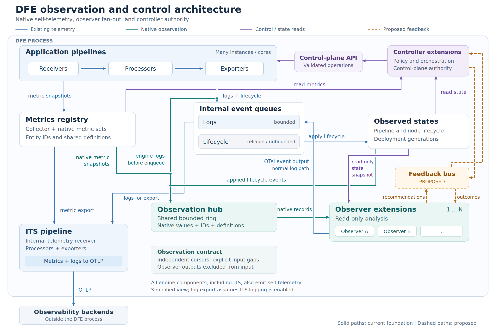

# Engine Observer Architecture

## Scope

This document describes the observer foundation's data paths, ownership,
thread hosting, and input-retention limits. The feedback capability and
hardening directions are proposals, not implemented features.

## High-level architecture

[Editable SVG](images/engine-observer-architecture.svg) |
[Full-resolution PNG](images/engine-observer-architecture.png)

Solid paths show the current foundation. Dashed amber paths show the
[proposed observer/controller feedback bus](engine-observer-feedback.md).
The diagram assumes ITS logging is enabled and omits repeated instrumentation
arrows: ITS, controller tasks, and other engine components also emit
self-telemetry.

| Component | Current responsibility |
| --- | --- |
| Application pipelines | Process pdata and report metric snapshots, structured logs, and lifecycle events. |
| Metrics collector and registry | Aggregate collected producer snapshots, retain entity and metric definitions, and provide the normal export state. |
| Internal event queues | Route logs through bounded delivery queues and lifecycle events through a separate reliable, currently unbounded queue. |
| Observed-state store | Apply lifecycle events and retain the current pipeline and runtime-instance states. |
| Observation hub | Share a bounded stream of native observations across independent subscriptions. |
| Observer extensions | Analyze native observations, read state snapshots, and emit named OTel events. |
| ITS pipeline | Receive internal telemetry and process/export metrics and configured logs. |
| Controller extensions | Read metrics and observed state, and invoke semantic control-plane operations. |

## Data paths and ownership

1. Pipeline metric snapshots enter the collector. Normal aggregation happens
   once, and the observation path moves the collected value vector into a
   shared immutable record. Observers retain native integer values,
   distributions, metric-set keys, entity keys, and definitions without
   consuming or resetting the export accumulator.
2. Structured logs are tapped by internal async reporters before queue
   delivery. Logging filters still apply. Console-direct and disabled logging
   do not provide structured log inputs to observers.
3. Lifecycle events pass through their reliable queue and are handled by the
   observed-state store. Admitted lifecycle copies are published after
   successful state handling and lock release.
4. The hub fans out `Arc<ObservationRecord>` values. Each observer has an
   independent cursor; the queued payload is shared across subscribers.
5. Observers also receive a read-only observed-state handle. Its current
   `snapshot()` implementation clones the state map while holding its mutex.
   This read is separate from the input stream and is not an atomic snapshot
   aligned with a metric or event record.
6. Observer-produced OTel events use the normal logging delivery path. The
   reserved output target is excluded from every observer's input tap. These
   output events can be filtered or dropped and do not acknowledge delivery.
7. Controller extensions have the control-plane handle. Observer contexts do
   not receive that handle. Changes made by controllers become observable
   through subsequent metrics and lifecycle events.

Registry keys are scoped by a fresh `registry_epoch`. A key alone must not be
used to join observations across registry restarts. Publication sequence
orders records within a registry lifetime; it does not establish cross-signal
causality or an atomic engine view.

## Threads and CPU placement

Each configured observer currently reuses the controller-extension host: one
OS thread, a single-threaded Tokio runtime, and a `LocalSet`. The task future
may contain `!Send` state. Separate threads provide independent scheduling
when another observer blocks or performs substantial CPU work. Runtime task
errors and unwinding panics are handled by the observer wrapper.

A dedicated thread does not reserve a CPU. Observer threads have no explicit
pinning and inherit the host's allowed CPU affinity. They can compete with
ITS and application pipelines. The ITS pipeline attempts to pin itself to
the first visible CPU; the foundation does not colocate observers with ITS
or reserve separate observer cores.

This hosting model is an implementation choice, not a requirement of native
observation. A future host could assign lightweight observers to a small
number of shared single-thread executors, preserving each task's thread
assignment and `!Send` state. Dedicated hosting could remain available for
heavier observers. Shared executors require cooperative work limits because
one task that does not yield can stall its peers. Placement and CPU budgets
would need to be explicit.

## Input retention limits

| Setting | Default | Meaning |
| --- | --- | --- |
| `max_observers` | 8 | Maximum configured observers and live subscriptions admitted by the hub's limits. Set to 1 to enforce a single-observer budget. |
| `channel_capacity` | 256 | Number of records in the one shared overwrite ring. |
| `max_payload_bytes` | 65536 | Logical retained-payload admission ceiling for one input record. |

A record is an internal telemetry envelope: one metric-set snapshot for one
measurement bucket, one structured log, one lifecycle event, or a rejection
marker. A metric-set snapshot can contain several metric fields.

When a reader falls behind the ring, it receives `Lagged(n)` and resumes at
the oldest retained record. Producers do not wait for a reader to consume
records. An oversized or unsupported-shape input becomes a small
`Rejected(kind)` marker while normal telemetry processing continues.

At the defaults, the sum of admitted queued payload budgets is at most
256 times 64 KiB, or 16 MiB. This is not preallocated payload storage or a
process RSS limit. Envelopes, containers, in-progress publications, thread
stacks, observer histories, and retained frame references add memory.
Holding a received `Arc` can extend a record's lifetime beyond the ring's
retention window.

Size the ring against incoming record rate, bursts, and acceptable consumer
pauses. At 1,000 records per second, 256 slots represent approximately 256 ms
of buffering in a steady stream. A burst can consume that window much faster.
Output events follow the existing logging limits rather than these input
admission settings.

## Further reading

- [Configuration and extension authoring](engine-observer-extensions.md)
- [Proposed feedback loop](engine-observer-feedback.md)
- [Risk analysis and mitigation options](engine-observer-risks.md)
