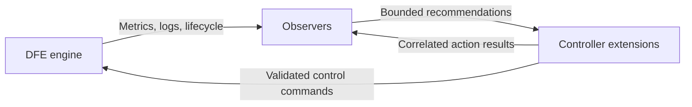

# Observer and Controller Feedback Proposal

## Status and intent

This is a design proposal for communication between engine observers and
controller extensions. No feedback bus, automatic observer restart, or
observer-driven actuation is implemented by the foundation.
See the [architecture overview](engine-observer-architecture.md) for the
current data paths and runtime model.

The goal is an intentional closed loop in which observers report findings
or recommendations, controller extensions decide and execute policy, and
observers evaluate the resulting engine behavior. Observer contexts retain
their read-only access to engine state.

## Current capabilities

Observers receive native metric snapshots, structured logs, applied lifecycle
events, a read-only state handle, and an OTel event output capability.
Controller extensions receive observed state, the telemetry registry, and
the semantic control-plane handle. That handle supports operations such as
pipeline reconfiguration and shutdown, with APIs to inspect operation status.

Observer output events are exported normally but excluded from every
observer's native input stream. A controller extension subscribing to that
same observation stream would not receive those outputs either. The current
foundation provides no direct observer-output subscription capability in the
controller context.

Logging is filtered and may drop or delay events. A control feedback transport
must therefore have an explicit delivery contract independent of ITS export.

## Proposed flow

Use an engine-owned, bounded communication capability between the two
extension kinds. Observers publish findings or recommendations through a
restricted sender. Controller extensions subscribe to configured topics or
targets, evaluate policy, and invoke existing control-plane operations.
Action results return through a bounded result capability. Engine effects
also reappear through the normal observation stream.

Named OTel events remain an audit trail for findings, policy decisions,
action outcomes, and suppression. They are not the acknowledgement mechanism
for the proposed coordination bus.

## Message identity and evidence

A small typed recommendation should identify:

- Its correlation ID, producer observer ID, and message kind.
- The target engine/pipeline/node and the relevant registry epoch and
  deployment generation.
- Its observation time, expiry, evidence window, and evidence completeness.
- A proposed action or finding, with a bounded evidence summary or reference.

Do not attach arbitrary histories, retained input-frame collections, or
unbounded payloads to coordination messages. Message schemas and encoded
or retained size need explicit bounds.

Result messages should distinguish acceptance from completion. Possible
states include accepted, rejected, superseded, expired, applied, and failed.
A result must carry the correlation ID and target generation. For an
asynchronous control-plane operation, the controller should retain a bounded
operation reference and report its eventual outcome. Receiving a transport
message does not mean the requested engine change succeeded.

## Bounded delivery and overload

The following limits require explicit configuration and enforcement:

- Subscribers, admitted targets/keys, queue slots, and bytes per message.
- Outstanding recommendations and control-plane operations.
- Result retention, acknowledgement/retry state, and retry lifetime.
- Publication and action rates, globally and per target.

Publication from observers must not wait for a controller to make progress.
When admission fails, return or expose a capacity outcome and increment
independent health counters. Do not retry indefinitely or create an
unbounded backlog of recommendations.

Repeated advisory findings can be coalesced into a bounded latest-state slot
for an admitted target. This policy does not apply indiscriminately to
one-shot actions or acknowledgements: their overload semantics must state
whether they are rejected, retried within a budget, or superseded. Coalescing
also needs a global key cap; unique targets must not defeat the bound.

State whether messages survive restarts. An initial process-local design
could be explicitly ephemeral, requiring reconnection and state
reconciliation after restart. Durable delivery would require a separately
bounded persistence and recovery design.

## Policy ownership and stability

Controller extensions own authorization and arbitration. The observer's
finding is evidence for a decision, not authority to execute it.

Before an action, a controller policy should check target existence, current
generation, message expiry, evidence freshness/completeness, and permitted
actions. Conflicting recommendations need one policy owner per target or a
defined arbitration mechanism rather than uncontrolled concurrent writes.

Idempotency keys, deduplication, action-rate limits, cooldowns, hysteresis,
and limits on concurrent operations reduce oscillation and repeated action
storms. Deduplication and cooldown maps must themselves have bounded
cardinality and retention. The policy should suspend automatic action when
its required evidence has gaps or becomes stale.

Keep automatic actuation disabled initially. Shadow mode can record proposed
actions and compare their expected effects against real behavior without
changing the engine. Read-only advisory operation remains useful even if
automatic action is never enabled.

## Directions for later evaluation

A reverse capability could also carry explicit observer directives, such as
bounded changes to observation detail or temporary analysis settings. Such a
capability would need versioned configuration, clear ownership, and bounded
lifetimes; it is outside the current foundation.

The first validation scenarios should cover duplicate and stale messages,
conflicting observers, full queues, unavailable controllers, delayed or
failed control operations, restarts, and recovery. They should assert both
bounded state and the absence of repeated or oscillating actions.

See the [risk analysis](engine-observer-risks.md) for resource and lifecycle
limits that remain even without actuation.
