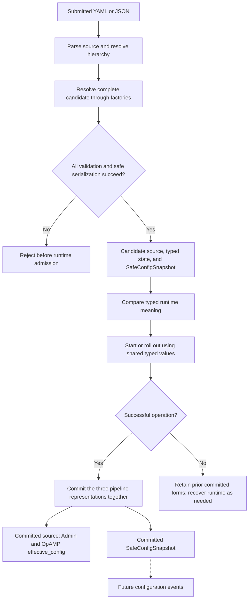

# RFC 0000: Configuration Framework for the OTel Arrow Dataflow Engine

## Summary

Resolve component configuration through factories before runtime admission, and
keep three distinct representations: parsed source for updates and trusted
management, immutable typed values for runtime creation and semantic comparison,
and a precomputed `SafeConfigSnapshot` for privacy-preserving reporting. Require
every factory to declare a resolver and an explicit snapshot policy. Commit the
three representations together for each successful pipeline update, and support
revision-guarded partial edits without reconstructing source from redacted data.

This is a draft proposal for discussion, informed by the implementation
prototype linked under [Delivery and validation](#delivery-and-validation).
It does not describe functionality already available on upstream `main`.
The draft number follows the [RFC process](README.md#numbering).

## Motivation

Component configuration currently crosses several boundaries: file loading,
schema validation, factory creation, live reconciliation, and management
reporting. Keeping component payloads as generic JSON through those boundaries
makes their meaning and disclosure rules difficult to enforce consistently.

The framework should address these problems together:

- A component may parse and validate its configuration repeatedly, including
  once per pipeline core. Admission and creation can disagree if they use
  different parsers or omit semantic validation.
- Comparing submitted JSON treats aliases and omitted defaults as changes even
  when the runtime behavior is identical. Comparing redacted output has the
  opposite problem: a changed credential can appear unchanged.
- Arbitrary JSON cannot reliably be sanitized by walking keys such as `headers`
  or `password`. URLs, private keys, plugin properties, and literals can contain
  sensitive data under many names.
- Reporting and editing need different representations. A safe display cannot
  supply omitted values for replacement requests. Existing Admin and OpAMP
  management clients still need complete committed source, including secrets.
- Partial edits need concurrency protection and a way to address normalized
  fields without discarding the source's private values or supported aliases.

The intended outcome is one component resolution contract, one runtime meaning
for each accepted candidate, and explicit choices about where configuration may
be disclosed. This supports [issue #3848][tracking-issue] while preserving the
engine's existing per-pipeline rollout and recovery model.

## Guide-level explanation

### Three views of one configuration

| Representation | Purpose | Contains sensitive values? |
| --- | --- | --- |
| Source | Construct updates and serve trusted Admin/OpAMP management clients | Yes; retain submitted operational values |
| Resolved runtime state | Create components and compare runtime meaning | Yes, where required by the component |
| `SafeConfigSnapshot` | Supply an explicitly safe reporting view | Redact or omit according to mandatory factory policies |

Source means the parsed submitted model. It does not preserve original YAML
bytes, comments, anchors, formatting, or provider expressions before expansion.
Supported component field aliases can remain in the parsed component payload.

Consider an exporter with a default timeout and an inline credential. Omitting
the timeout and writing its default explicitly can resolve to the same typed
value. Its safe snapshot can include the timeout and a `[REDACTED]` credential.
Changing only that credential must still replace the runtime component even
though the two safe snapshots look identical.

Admin HTTP configuration reads and OpAMP's `effective_config` continue to return
committed source, including sensitive data. These interfaces support trusted
management and full replacement. A future configuration event must explicitly
select `SafeConfigSnapshot`. This proposal adds neither that event nor a new
safe-config HTTP endpoint.

### Lifecycle



The commit boundary is a pipeline operation. A full-engine update can apply
several pipeline operations in sequence; it is not a transaction across them.
An unsuccessful rollback can leave a mixed or degraded runtime even though the
previous pipeline definition remains committed.

### Adding a component

A contributor defines a concrete runtime configuration type and one resolver
that parses, validates, defaults, and normalizes the submitted payload. The
factory registration also chooses one visible snapshot policy:

- `TypedSafe`: serialize the complete resolved type, after auditing every field
  and using secret-safe field types where needed.
- `CustomSafe`: provide a component-owned safe representation when ordinary
  serialization of the runtime type is unsuitable.
- `Omit`: replace the entire component `config` with `[OMITTED]` when its schema
  or contents cannot be shown safely.

Creation receives a resolved node or extension envelope and retrieves a checked
`Arc<T>` through `component_config::<T>()`. It does not deserialize JSON again.
Multiple pipeline cores reuse the same immutable value. A no-config component
still declares a resolver and policy, using a unit or default typed value.

Omitting an envelope's `config` field means `{}`. Existing explicit values,
including `null`, are preserved for the resolver to accept or reject. For
example, these node declarations are equivalent ingestion inputs:

```yaml
nodes:
  first:
    type: processor:batch
  second:
    type: processor:batch
    config: {}
```

This is a node-map excerpt, not a complete pipeline. Components with required
settings still reject an empty configuration.

### Updating a running pipeline

Existing full `PUT` replacement remains usable: fetch committed source, edit it,
and submit the complete pipeline. A partial update instead reads
`configRevision` from pipeline details and submits only intended edits:

```http
PATCH /groups/default/pipelines/main?wait=true
Content-Type: application/json
```

```json
{
  "expectedRevision": 7,
  "changes": [
    {
      "operation": "set",
      "path": ["policies", "resources", "core_allocation"],
      "value": {"type": "core_count", "count": 2}
    }
  ],
  "stepTimeoutSecs": 60,
  "drainTimeoutSecs": 60
}
```

The server edits its committed source and performs normal resolution and
rollout. Unchanged credentials need not be sent. A stale revision returns a
conflict; the client must refresh and explicitly reapply its intent. Display
markers never mean "keep the old secret".

## Reference-level explanation

### Ownership and resolution layers

The existing root model, pipeline groups, nodes, connections, extensions,
policies, topics, and observability pipeline remain the configuration envelope.
`(group_id, pipeline_id)` remains the operational pipeline address. Explicit
connections describe the graph; nodes and extensions select factories by URN.
This proposal does not replace those concepts with Collector-style ordered
component lists or introduce new topic delivery semantics.

Resolution has four distinct stages:

1. **Provider loading.** `config_provider::resolve_config` obtains source content
   and format. The CLI performs its existing environment substitution before
   parsing. Provider URIs and contents are sensitive artifacts.
2. **Structural parsing.** `OtelDataflowSpec::from_yaml` and `from_json` validate
   the envelope, canonicalize URNs, and check structural and policy rules.
   `NodeUserConfig` and `ExtensionUserConfig` remain ingestion types.
3. **Hierarchy resolution.** Config-crate `OtelDataflowSpec::resolve()` produces
   `ResolvedOtelDataflowSpec`, resolving policy precedence, topic scopes,
   deterministic pipeline ordering, and regular/observability roles. Its
   component payloads are still ingestion values.
4. **Engine component resolution.** The factory registry resolves those payloads
   to typed runtime state and safe snapshots. Controller preparation compiles
   context bindings and validates the complete candidate before admission.

The config crate owns ingestion, hierarchy/policy resolution, providers, and
secret primitives. The engine owns typed component state and factory contracts.
Components own their schemas, semantic validation, and disclosure decisions.
The controller owns candidate preparation, retained source, rollout, and commits.

`Controller::prepare(source, options)` returns a `PreparedEngineConfig` that
startup consumes. Validation-only callers may discard it. Host initialization
can inspect its resolved pipelines without resolving them again. Resolve each
component once per candidate; runtime creation, additional cores, Admin reads,
and OpAMP heartbeats must not trigger another resolution.

Preparation must cover regular pipelines, the observability pipeline, pipeline
extensions, and controller extensions. A pipeline-only update resolves its
complete target pipeline in the existing engine context. A full-engine update
resolves the complete desired configuration before starting pipeline operations.

### Mandatory factory contract

Every linked receiver, processor, exporter, pipeline-extension, and
controller-extension factory declares:

| Declaration | Responsibility |
| --- | --- |
| Concrete runtime type and resolver | Parse, apply defaults, validate, and normalize into immutable `T` |
| Semantic comparison | Compare actual runtime meaning using `PartialEq` or a component-owned callback |
| `ConfigSnapshotPolicy` | Select `TypedSafe`, `CustomSafe`, or `Omit` explicitly |
| Creation callback | Consume the matching resolved envelope and obtain checked `Arc<T>` access |

Replace the optional `validate_config` hook with this contract. Helpers or
macros generate type erasure, safe serialization, comparison, and downcast glue;
the policy must remain visible at registration. Custom parsers return their
normalized runtime type. Existing semantic checks, including cross-field,
ownership, and range validation, must survive migration; generic deserialization
is insufficient when a component already has a validating parser.

Engine-owned `ResolvedComponentConfig` holds the immutable type-erased value,
its typed equivalence callback, and a precomputed safe value. Resolved node,
extension, and pipeline envelopes retain the metadata required for creation.
Creation callbacks and `PipelineFactory::build` consume these resolved forms.
A checked accessor mismatch returns a value-free type error rather than
formatting the submitted payload. A resolver's policy must match registration.

Closed schemas reject unknown fields, including nested security settings.
Serde-backed schemas normally use `deny_unknown_fields`; flattened schemas need
a strict wire decoder where those attributes cannot be combined. Open plugin
schemas and arbitrary maps remain open and use `Omit` unless their complete
output can be audited.

`TypedSafe` requires an audited `Serialize` implementation for the complete
resolved value. A typed struct containing a secret in a plain `String` is not
safe automatically. `CustomSafe` owns the safety of the entire returned subtree
and must not copy unknown source fields. `Omit` emits the literal JSON string
`"[OMITTED]"` for the complete component `config`, not an empty object or a
partially filtered subtree. There is no raw-value fallback for any policy.

### Safe snapshot construction

`SafeConfigSnapshot` retains the engine/group/pipeline JSON envelopes while
using each component's precomputed safe value. Defaults and normalization may
therefore appear in this view even when absent from source. Every top-level
`engine.custom` value becomes `[OMITTED]`; keys remain visible.

Construction starts from a conservatively omitted envelope and installs only
resolved safe component values. The API must not wrap an arbitrary unsanitized
source envelope or provide mutable access that bypasses this boundary. Safe
serialization failure rejects the candidate before admission. Conservative
assembly does not permit skipping a mandatory resolver.

Safe snapshots are reporting artifacts, not replacement input, an equivalence
key, an encrypted source archive, or a guarantee that the configured service is
secure. Their safety depends on factory policy audits. They may still disclose
topology, component identities, and nonsecret settings, so future consumers must
define their own audience and access controls.

### Runtime equivalence

Compare typed values using real secret values and normalized runtime fields.
Types without suitable `PartialEq` implement a component-owned semantic
comparator; incidental caches or display fields must not dictate replacement.
Compare graph metadata and normalized runtime policies separately.

- Alias- or default-equivalent inputs can yield `noop`.
- A changed inline secret must yield a runtime change even if snapshots match.
- A changed snapshot presentation alone must not require component replacement.

Comparison observes configured reference identities, such as a TLS file path,
not every external resource's contents. Rotating bytes at an unchanged path
follows the component's existing reload behavior. This RFC does not introduce
external-secret fingerprints or a universal credential-reload lifecycle.

### Admission, rollout, and representation consistency

Build candidate source, resolved state, and safe snapshot before startup or live
admission. Unknown URNs, parser or semantic-validation failures, policy
mismatches, invalid markers, and safe-serialization failures reject the
candidate. Existing graph/capability checks and contextual checks, including
rate-limiter binding names and cardinality, remain mandatory for both full-engine
and pipeline-only updates.

Live operations retain the existing `create`, `noop`, `replace`, and `resize`
planning and readiness gates. A replacement brings new cores through `Admitted`
and `Ready` before retiring the corresponding old cores. Rollout ownership,
revision fences, draining, and runtime-recovery coordination remain in force.
Successful admission alone does not commit a candidate.

For each successful pipeline operation, commit its source, resolved runtime
record, and safe snapshot together. A semantic no-op may accept a new source
form without restarting cores. Rejected admission and failed rollout retain the
previous committed pipeline forms; a successful rollback restores the previous
serving configuration. If rollback itself fails, expose `rollback_failed` and
the observed mixed/degraded serving state. Retaining the previous committed
definition does not imply that runtime recovery succeeded.

Full-engine reconciliation remains nontransactional across pipelines. If one
pipeline succeeds and a later operation fails, the earlier pipeline stays
committed with its three consistent forms. Engine/group metadata finalization
occurs only after overall success. Do not report this as an atomic engine-wide
configuration switch.

Controller extensions and the observability pipeline have no live replacement
lifecycle in this proposal. Reject their additions, removals, or runtime-
significant changes before starting pipeline operations; applying such changes
requires a restart. Alias/default-equivalent changes remain acceptable. Existing
restrictions on runtime topic profiles, memory limiters, and other engine-scoped
resources also remain; typed resolution does not make every setting mutable.

### Privacy, secrets, and diagnostics

Add `RedactedString`, backed by `secrecy::SecretString`, with these contracts:

- Deserialize real cleartext, rejecting reserved display markers.
- Require explicit `expose()` for runtime cleartext access.
- Serialize as `[REDACTED]` and keep `Debug` redacted.
- Compare equality using the real value, not its display.

Use type-owned safe serialization for known inline secrets: ClickHouse
passwords, OAuth client secrets and signing keys, static HTTP/gRPC header
values, inline TLS private keys, proxy credentials, and credential-bearing
endpoint URLs. Redact complete HTTP/gRPC/OTAP endpoint values, including signal
overrides, because secrets can occur in authority, path, or query fields.

Use `Omit` for Kafka arbitrary properties, plugin/free-form schemas, raw
`serde_json::Value` payloads, and any configuration whose complete disclosure
safety is uncertain. Audit arbitrary literals, salts, resource attributes, and
remote registry locations rather than assuming that only credential-named
fields are sensitive.

Reserve `[REDACTED]` and `[OMITTED]` as display markers:

- `RedactedString` rejects both on input.
- A complete component `config: "[OMITTED]"` is rejected.
- Submitted marker values under `engine.custom` are rejected.
- PATCH recursively rejects either marker in any newly supplied value.

These are targeted input rules, not a claim that every arbitrary business
string in every open source schema is recursively classified. Markers never
request credential restoration. A safe snapshot must not silently become
operational source when exported and replayed.

Admin engine/group/pipeline configuration reads serialize the corresponding
committed source views, including private keys, credentials, arbitrary payloads,
and `engine.custom`. OpAMP reports that source through its protocol-defined
`effective_config` field and `EffectiveConfig` message. Keep those wire names
unchanged. Neither reporting path substitutes `SafeConfigSnapshot`, rebuilds
component snapshots, performs a late generic redaction walk, or serves an
uncommitted candidate.

This trusted-management contract preserves existing read/edit/PUT workflows.
Protect Admin access, remote transport, the OpAMP server, saved source, editor
drafts, and process memory accordingly. Secret wrappers and safe snapshots do
not secure those sources or provide authorization.

Harden diagnostics independently. Provider URIs/content, parser errors,
component creation errors, and panic payloads can reveal submitted values.
Control-plane boundaries return value-free status and component attribution
instead of forwarding arbitrary payload text. Provider debug output hides
contents; URL-bearing fetch errors and validation confirmations must not print
private locations. Captured panic reporting discards arbitrary payload text.
Process panic hooks, low-level parsing APIs, and component-owned runtime logs
still need explicit auditing; this framework does not sanitize all logging.

### Revision-guarded editing

Add `configRevision` to pipeline details and a `PipelineUpdateRequest` for
`PATCH /groups/{group}/pipelines/{id}`. The revision is the existing engine-wide
committed source counter, distinct from a pipeline's runtime generation. A
successful update, including a semantic no-op, advances it; another pipeline's
commit can conservatively invalidate a draft.

Acquire the normal pipeline-operation reservation, check `expectedRevision`,
apply the edit batch to private committed source, then resolve and admit the
complete candidate through the existing rollout path. Stale revisions return
`409 Conflict`; missing targets return `404`; invalid edits or unsupported
mutations return `422`. Rejection must not create runtime components or change
committed source, resolved state, safe snapshot, or revision.

Paths are arrays of literal object keys, so node IDs containing `/` need no JSON
Pointer escaping. `set` may create absent object parents; `remove` deletes a
field if present. Empty paths are invalid. Arrays are replaced as a whole.
Removing an optional field can restore a default; removing a required setting
fails normal candidate validation.

Limit candidates to 128 levels from pipeline-root depth zero. Every object
field or array element adds a level. Preflight paths plus replacement subtrees,
every edit in a batch, and the complete edited pipeline before rollout. Return
value-free errors for excessive depth. Existing request-size and bounded
operation controls still apply; a depth bound is not a byte-size bound.

Factories may declare a separate, optional, idempotent private-source edit
normalizer for supported aliases and canonical field layouts. Normalize only
touched component edit bases. Preserve runtime meaning and private values;
reject conflicting aliases. If normalization would move the addressed authored
field, retain that layout for the edit. Whole-component replacements continue
to accept source syntax. Normalization must neither invoke runtime creation or
the candidate resolver nor reconstruct source from `SafeConfigSnapshot`.
The resulting complete candidate is resolved once through normal admission.

The SDK supplies sparse-diff helpers. TUI scaling sends a resource-policy edit;
external-editor drafts retain their original source baseline and revision,
including when reopened. Send only changed fields and do not resend unchanged
credentials. Refreshing a draft must not silently replace its concurrency token.
Draft contents remain sensitive because their baseline is a management view.

### Compatibility and migration

Preserve sensitive source reporting and existing full pipeline `PUT` throughout
the factory cutover. Do not introduce an intermediate release that returns only
safe snapshots through management APIs. Adding PATCH does not require existing
clients to use it, and `configRevision` is an additive response field. Strict
client decoders and newer clients talking to older servers still require
compatibility tests; this RFC does not provide automatic capability negotiation
or a PATCH fallback for mixed-version fleets.

Omitted `config` becoming `{}` preserves explicit existing payloads, including
`null`. Stricter parsing can reveal previously ignored misspellings. Reserved
marker rejection can invalidate configurations that used display-marker
strings as actual credentials. These changes require release notes.

Remove the unused pipeline-level `type` discriminator as a separately reviewable
schema change. The embedding application already chooses `PipelineFactory<PData>`;
`df_engine` uses the OTAP factory. Node and extension `type` fields still select
components. This removal is not a prerequisite for typed resolution.

Migration must remove obsolete pipeline `type: otap` or `type: otlp` entries
from files and complete replacement payloads, including remote configuration.
Do not remove node/extension types or unrelated protocol selectors. Old clients
that always serialize pipeline `type` can fail against strict new servers.
Maintainers must choose a coordinated migration, temporary input compatibility,
or deferral before shipping this part; the prototype alone does not solve
mixed-version compatibility.

### Delivery and validation

The prototype is organized into independently testable stages:

1. [Primitives and ingestion defaults][prototype-foundation]: secret primitives,
   resolved containers, snapshot policies, and omitted-config handling, without
   changing runtime factory callbacks.
2. [Atomic factory cutover][prototype-resolution]: migrate every production,
   feature-gated, and test factory and its secret consumers together; integrate
   all admission paths, semantic comparison, and per-pipeline commits.
3. [Live editing and operator experience][prototype-editing]: revisions, PATCH,
   SDK/TUI changes, and documentation. Keep pipeline-type removal in a distinct
   commit so its compatibility decision remains separable.

These links are implementation evidence, not prerequisites for reviewing this
self-contained RFC. Partial factory migration with temporary raw-config runtime
paths is not an accepted final state.

Acceptance coverage must demonstrate:

- Secret serialization/debugging, explicit exposure, real equality, reserved
  markers, omitted versus explicit config, and required-field rejection.
- Typed/default-normalized, custom-safe, and omitted snapshots; `engine.custom`
  omission; safe-serialization errors, downcast failures, and policy mismatches.
  Include public-field controls to ensure tests exercise useful safe output.
- Registry-wide resolver/policy coverage across all scopes and feature-gated
  registrations; one resolution per candidate and shared values across cores.
- Alias/default no-ops, secret-only replacements, validating-parser rejection,
  and contextual limiter-binding rejection before runtime creation.
- Startup, observability/controller-extension restrictions, successful commits,
  failed admission, rollback, and rollback-failure reporting. Assert consistency
  of source, resolved state, snapshot, and revision at each boundary.
- Sensitive Admin whole/group/pipeline and OpAMP source reporting alongside
  independently safe snapshots; full GET/edit/PUT round trips.
- PATCH success, stale revisions, invalid paths/values, markers, depth limits,
  removal, canonical/authored aliases, and whole-array replacement. Cover TUI
  draft revisions and unchanged credentials, plus a real-process edit scenario.
- Existing/new client and server combinations, with explicit expectations for
  unsupported PATCH and pipeline-type compatibility. Do not claim mixed-version
  support based only on same-version tests.

Implementation validation follows affected-crate checks, targeted tests,
`cargo xtask quick-check`, full `cargo xtask check`, applicable feature/platform
checks, changelog validation, Markdown lint, sanity checks, and whitespace/link
checks. Document every new test with `Scenario` and `Guarantees`, and synchronize
on observable state rather than timing assumptions. External registry failures
must be reported separately rather than disabling tests to pass a boundary.

This RFC-only branch changes no runtime behavior and needs documentation checks,
not the implementation's Cargo suite or a changelog entry.

## Drawbacks

- The factory cutover touches many crates and registrations at once. Type
  erasure introduces checked runtime downcasts that Rust cannot verify across
  independently registered factories.
- Retaining source, typed values, and safe JSON increases memory use. Sharing
  `Arc<T>` avoids per-core copies but can extend sensitive-value lifetimes.
- Explicit policies require ongoing human audits. `TypedSafe` does not prove
  that every nested string is public; `Omit` reduces diagnostic usefulness.
- Complete candidate resolution does cold-path work even for no-op updates.
  Engine-wide revisions can produce conflicts between independent pipeline edits.
- Trusted management reporting remains sensitive. Safe snapshots cannot make
  existing Admin/OpAMP responses suitable for public events or unrestricted logs.
- Strict input checks and pipeline-type removal can break existing configurations
  or clients. The latter needs its own deployment decision and migration plan.

## Rationale and alternatives

| Alternative | Reason for this proposal's choice |
| --- | --- |
| Keep raw JSON, validate optionally, parse during each creation | Allows validation/creation drift, repeated work, and syntax-based reconciliation |
| Redact with generic key walkers | Cannot reliably classify URLs, opaque maps, literals, or component-specific secrets |
| Serialize raw source when no safe serializer exists | Makes disclosure the default exactly where safety is uncertain |
| Compare safe snapshots for rollout equivalence | Hides secret-only changes and confuses display with runtime meaning |
| Restore secrets when replaying markers | Ambiguous for arrays, removals, omitted subtrees, and concurrent edits; sparse source edits express intent explicitly |
| Return only safe snapshots from existing management APIs | Breaks complete source read/edit/PUT workflows and changes the trusted-management contract |
| Omit every component permanently | Safe but unnecessarily hides audited defaults and useful public configuration |
| Add a derive/lint classifying every field first | Promising enforcement, but a separate mechanism; mandatory explicit policies and conservative omission provide the initial boundary |
| Make full-engine rollout transactional | Requires a larger placement, lifecycle, and recovery design; per-pipeline representation consistency is a narrower achievable guarantee |

Without this work, configuration meaning and privacy continue to depend on
separate parsing, comparison, and reporting paths. The chosen design puts each
component's semantic and disclosure decisions at its factory while keeping
engine lifecycle and management contracts explicit.

## Prior art

The Go Collector's [`configopaque.String`][collector-opaque] masks sensitive
fields during formatting/serialization and requires explicit conversion to
obtain their value. This supports type-owned redaction rather than field-name
guessing. Its usefulness still depends on classifying sensitive schema fields.
Our mandatory policy adds complete omission where that classification cannot
be established for an entire component schema.

The Collector's [`print-config` command][collector-print], inspected on
2026-10-25, defaults to redacted output and validation, with an explicit
unredacted mode. It obtains component configuration through the config provider
and marshals it with or without unredacted handling. The lesson for this proposal
is to make the representation and disclosure intent explicit. We do not add a
print command or copy those modes onto existing Admin/OpAMP interfaces. A future
CLI would need its own compatibility and output contract.

Within this project, [component inventory](0001-component-inventory.md) proposes
auditable metadata for security-relevant components, while
[pressure-aware throttling][throttling-rfc] illustrates contextual policy binding
beyond component JSON parsing. Resolver coverage can use the factory registry,
but it does not replace broader security inventories, contextual admission
checks, or the execution model.

## Unresolved questions

- Should the unused pipeline `type` field be removed with operator tooling,
  accepted temporarily on input, or deferred until mixed-version clients migrate?
- What capability discovery or explicit fallback should SDK/TUI clients use when
  talking to servers without PATCH or `configRevision`? Preserve current PUT
  behavior while deciding this; do not silently remove concurrency protection.
- Who owns disclosure-policy audits, and what review evidence is required when a
  factory moves from `Omit` to `TypedSafe` or `CustomSafe`?
- Which future event consumers may receive safe snapshots, with what retention,
  size limits, and access controls? Capture committed generations explicitly
  when designing those events.

## Future possibilities

- Emit configuration events using the already committed `SafeConfigSnapshot`.
- Add derives/lints for public, secret, reference, and non-exportable fields, and
  enforce policy audits mechanically where practical.
- Introduce version-aware editing tools and possibly more granular revisions if
  engine-wide conflicts become operationally costly.
- Design a safe-by-default print/inspection command with explicit output and
  privileged-disclosure semantics, rather than reusing a management response.
- Specify dynamic external-secret reloads or transactional multi-pipeline updates
  separately; neither is implied by immutable typed resolution.

[tracking-issue]: https://github.com/open-telemetry/otel-arrow/issues/3848
[prototype-foundation]: https://github.com/lquerel/otel-arrow/pull/13
[prototype-resolution]: https://github.com/lquerel/otel-arrow/pull/14
[prototype-editing]: https://github.com/lquerel/otel-arrow/pull/15
[collector-opaque]: https://pkg.go.dev/go.opentelemetry.io/collector/config/configopaque
[collector-print]: https://github.com/open-telemetry/opentelemetry-collector/blob/main/otelcol/command_print.go
[throttling-rfc]: 0002-pressure-aware-rate-throttling.md
