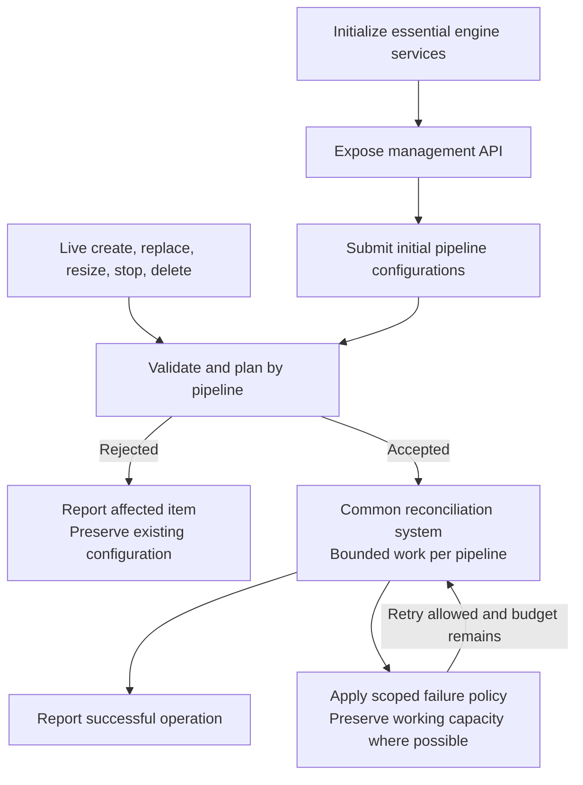

# RFC 0000: Independent Pipeline Lifecycle Reconciliation

## Motivation

A DFE process may host hundreds of distinct pipeline configurations, for example
one per tenant. One pipeline's invalid configuration or unavailable destination
should not interrupt unrelated pipelines or prevent an operator from repairing
the problem.

This RFC has three objectives:

1. Use one reconciliation system for initial startup and live changes.
2. Keep distinct pipeline configurations as isolated as their dependencies and
   shared process resources allow.
3. Apply consistent failure policies, distinguishing behavior we can build on
   today from behavior that needs further engine, controller, or admin API work.

The proposal covers creating, replacing, resizing, stopping, and deleting
pipelines. Broader changes such as durable desired state, new deployment
transactions, and advanced scheduling are future work, listed at the end.

## Guide-level explanation

### One lifecycle for startup and live changes

Startup establishes essential engine services and the management interface,
then submits the initial pipeline configurations to the same reconciliation
system used by live requests. Each pipeline uses the same validation, planning,
execution, and failure handling regardless of how it was submitted.

The difference is the starting state: a new pipeline has no working deployment
to preserve; a live replacement or resize usually does. Management remains
available while pipelines start, fail, or recover, including when none can run.

Invalid essential engine configuration or failure to initialize an essential
service can still prevent startup. Pipeline groups are organizational and policy
scopes, not automatic all-or-nothing failure domains. Actual dependencies, such
as a shared topic consumer, may prevent dependent pipelines from progressing;
unrelated pipelines continue.

### Consistent failure policies

The following table describes the target policy, not a claim that every row is
already implemented. The implementation section identifies the required work.
"Initial deployment" also applies when creating a new pipeline in a running
process.

| Condition | Initial deployment | Live change |
| --- | --- | --- |
| Malformed document, ambiguous identities, or invalid shared configuration | Reject the document. Exit if safe engine bootstrap is impossible; otherwise keep management available with diagnostics. | Reject the request and preserve existing configuration and service. |
| Invalid configuration in an identifiable pipeline, including a denied lint | Reject that pipeline and report why; continue with valid independent pipelines. | Reject that item; preserve its previous configuration and serving instances. Continue independent items. |
| Pipeline initialization fails, for example an exporter raises a connection error | Report that pipeline as failed or retrying. Retry known transient failures within a bounded policy; do not stop unrelated pipelines. | Fail the affected attempt, clean up candidates, and retain or restore the previous deployment where supported. Apply the same retry policy. |
| Destination becomes unavailable while the pipeline remains running | Follow the exporter's retry, buffering, and backpressure contract; report delivery degradation. | Apply the same contract. Do not restart healthy instances solely because an export request failed. |
| Resources are insufficient for the requested capacity | Report the affected pipeline's resource shortfall; continue others within available capacity. | Preserve existing capacity where possible and report that the requested change could not complete. |
| A serving instance exits with an error or contained panic | Recover that instance within its configured budget; keep healthy instances running. | Apply the same recovery policy, coordinated with any active rollout or shutdown. |
| Recovery is disabled or its retry budget is exhausted | Leave the affected instance or pipeline failed and visible; keep the engine and unrelated pipelines running. | Apply the same policy; require corrected configuration, explicit retry, or a supported recovery trigger. |
| A required pipeline dependency is unavailable | Hold affected ingress or apply configured bounded buffering/backpressure. Continue unrelated pipelines. | Keep a usable old path where possible; otherwise hold affected traffic under the same contract. |
| Readiness or rollout deadline expires | Fail the affected attempt and clean up its candidates. Report any incomplete cleanup. | Fail the affected attempt and attempt supported rollback. Report actual serving state if restoration fails. |
| Drain or cleanup cannot be confirmed | Keep resource ownership visible; do not reuse resources still owned by a runtime. | Report the stop, delete, resize, or replacement as incomplete or failed. A timeout is not proof of release. |
| An engine-level failure makes shared safety or essential control unreliable | Fail startup or shut down safely. | Enter protective shutdown; pipeline isolation cannot make unsafe shared machinery reliable. |

A destination connection failure is only an initialization failure if the
component raises it as such. Some exporters connect lazily or retry while
running. Their delivery health must not be confused with whether the runtime
started, and neither signal alone guarantees safe acceptance of new telemetry.

### Example: 100 pipelines in two groups

With 50 independent pipelines in each group and sufficient resources, one
pipeline's exporter initialization failure leaves the other 99 able to start.
The failed pipeline remains diagnosable and repairable through management.

For a live batch, successful independent changes remain applied and later items
are still attempted after one fails. A failed replacement retains or restores
its previous deployment where supported; a failed create has no previous
deployment. Report each item's result and make partial failure clear.

A live request arriving during startup uses the same lifecycle ownership rules.
Independent pipelines can progress; conflicting work on the same pipeline must
be rejected or serialized, and obsolete work must not overwrite a newer result.

## Reference-level explanation

### Validation and admission

Validate the document envelope and shared settings first, then identify and
validate individual pipeline changes. A rejected submission must not replace a
working configuration. Unknown or unsupported live mutations remain explicit
errors.

The proposed [pipeline linting RFC (#4574)][pipeline-linting] adds diagnostics
after structural and component validation and before admission; reuse that stage
for startup and live changes, with warnings non-blocking and denied lints treated
as admission failures. This RFC proposes scoping those failures to the affected
pipeline, extending the linting draft's current engine-wide startup failure rule.

Partial validation requires the loader to retain identifiable entries and their
errors instead of failing on the first bad entry. If malformed input prevents
reliable identification, reject the whole document. Until entry-level validation
exists, whole-document rejection remains an explicit implementation limitation.

An invalid entry must never be interpreted as a missing pipeline to delete.
When a submitted inventory contains rejected entries, skip omission-based
deletions; require a complete validated inventory for that destructive step.

### Reconciliation and operation results

Use the existing per-pipeline create, replace, resize, shutdown, and delete
mechanisms as the execution layer. Initial startup becomes an invocation of that
layer rather than a separate implementation of its failure rules.

Keep the requested target, operation result, and actual serving state distinct.
An accepted request is not a completed rollout. Status must identify the affected
pipeline, the failed stage and reason, and whether old, new, or mixed instances
remain. This does not require a new durable revision protocol.

The first implementation retains existing per-pipeline rollout and rollback
rules. Preserve working service where those mechanisms support it; report
rollback failure honestly. Successful changes to other pipelines are not rolled
back. Stop and delete must suppress recovery so background work cannot recreate
a pipeline being removed.

Bound launch concurrency, attempts, waits, and cleanup work. Reuse existing
recovery budgets where applicable, while adding explicit handling for failures
that occur before a serving instance exists. Invalid configuration is not
retried unchanged, and exhausted pipeline recovery must not escalate to engine
shutdown.

### Isolation and readiness

Keep lifecycle ownership scoped to a pipeline except where a real shared
constraint requires coordination. Preserve existing checks against stale
runtime generations. Avoid holding an engine-wide lifecycle guard across slow
initialization or draining when independent work could proceed safely.

Management readiness must not depend on every tenant pipeline being healthy.
Keep pipeline readiness, rollout completion, and delivery errors observable.
Reuse existing component readiness contracts initially; do not claim that they
already verify destination connectivity or end-to-end delivery.

Prepare required subscriptions before enabling dependent producers. Apply the
same rule to startup and live changes, including producers already running
during a consumer replacement. Where the engine cannot perform a safe handoff,
reject the unsupported change or report the affected dependency as blocked.

Isolation is logical within a process. Shared resource exhaustion, process
abort, and unsafe native failures can still affect every pipeline. The proposal
preserves the thread-per-core data plane and does not introduce a shared
lifecycle lock into telemetry processing.

### What can be reused and what needs work

The baseline is the existing [live reconfiguration implementation and
contract][live-reconfiguration]. "Reusable" means an existing mechanism, not
that the complete startup/live policy is already supported.

| Capability or policy | Existing support | Required work |
| --- | --- | --- |
| Per-pipeline create, replace, resize, shutdown, and delete | Reusable rollout, drain, cleanup, and best-effort rollback mechanisms. | Route startup through the same execution layer and preserve its correctness checks. |
| Recovery of one failed serving instance | Bounded recovery, generation checks, and coordination with rollout/shutdown exist. | In the controller, replace engine shutdown on disabled/exhausted recovery with a scoped failed condition; add bounded handling of initial launch failures. |
| Continue after one independent runtime rollout fails | Earlier successful changes already remain applied. | Change batch execution to attempt remaining independent items and aggregate their outcomes. |
| Reject a bad single-pipeline live update | Validation preserves the previous committed configuration. | Reuse it consistently; isolate errors from multi-pipeline input as described below. |
| Keep management usable during startup failures | Admin endpoints, operation IDs, and observed runtime status exist. | Change bootstrap ordering and lifecycle ownership; expose failed initial deployments and independent updates during startup. |
| Admit valid entries from a partially invalid document | Current loading and validation operate on the full engine configuration. | More substantial config-loader and controller work: per-entry diagnostics, shared-constraint validation, and safe deletion handling. |
| Report every item's admission and execution outcome | Rollout and reconciliation status provide a starting point. | Extend admin API/types for rejected entries and clear partial completion without changing existing fields silently. |
| Preserve safety across dependent pipeline changes | Topic subscriptions and readiness mechanisms exist. | Engine/controller work is needed for coordinated handoff across create, replace, resize, and recovery; reject unsupported transitions meanwhile. |

Implement in stages: first reuse the execution layer and scope runtime failure
handling; then make startup management and batch results consistent; then complete
entry-level validation and dependent-pipeline handling. Each stage must document
which policies it supports. Do not advertise full pipeline isolation while
whole-document validation or shared lifecycle guards still prevent it.

### Validation plan

Use the same failure scenarios through startup and live entry points:

- Start or update 100 independent pipelines across two groups; place the failing
  item early and late, and verify all other items are attempted.
- Reject one invalid pipeline or denied lint while admitting independent valid
  entries; separately reject malformed envelopes and prevent accidental deletion.
- Inject initialization failure, serving-instance failure, exhausted recovery,
  and failed rollback; verify management and unrelated pipelines remain usable.
- Exercise updates during startup and stop/delete during recovery; verify stale
  work cannot commit or restart a stopped pipeline.
- Exercise topic dependencies, readiness deadlines, and incomplete drains;
  verify traffic handling and resource ownership, not only reported status.

Use explicit readiness signals, controlled clocks for retry tests, and local
failure fixtures. Verify bounded resource use and preserve data plane progress
while many pipeline operations are active.

## Drawbacks

Independent failure handling requires more precise status than a single process
exit code. Operators need to detect partial failure even when the engine is
alive. Preserving a previous deployment can require temporary capacity, and
rollback remains limited by component capabilities.

Reusing lifecycle machinery reduces duplication, but entry-level validation and
dependency handling require substantive changes. The staged implementation must
make these limits visible rather than presenting partial support as complete.

## Rationale and alternatives

Failing the engine on any pipeline error is simpler for a small deployment but
lets one tenant interrupt all others. Making a group the failure boundary only
helps when its members are deliberately coupled. Independent reconciliation
matches the intended deployment of many distinct pipeline configurations.

Keeping separate startup and live paths makes it easier for their policies to
diverge. Reusing the existing execution layer provides a smaller starting point
than introducing new rollback, scheduling, and persistence systems together.

## Prior art

The DFE [live reconfiguration design][live-reconfiguration] already supplies the
rollout, generation, readiness, drain, and status mechanisms this proposal builds
on. The [pipeline linting proposal][pipeline-linting] supplies the complementary
admission diagnostics.

## Unresolved questions

- Which controller failures are genuinely engine-fatal, rather than scoped
  failures that should leave management and unrelated pipelines available?
- Which dependency transitions can existing topic and readiness mechanisms
  support safely, and which must initially be rejected?
- What minimal admin API additions expose failed initial entries and partial
  batches while preserving existing client behavior?

## Future improvements and extensions

These are separate follow-ups, not prerequisites for unifying reconciliation
and failure policies:

- Durable desired state, restart recovery, and explicit ownership between files
  and external controllers.
- Revision-based concurrency, request idempotency, watches, and richer operation
  history beyond the existing lifecycle ownership and status mechanisms.
- Component capability contracts for stronger readiness, state transfer,
  zero-downtime handoff, and partial-capacity serving.
- Fair tenant scheduling, resource reservations, automatic retry when capacity
  becomes available, and coordinated global retry budgets.
- Optional validate-all admission, coupled deployment sets, automated rollback
  policies, and deployment clients that wait for a selected set of pipelines.
- Stronger process isolation and multi-process placement where logical
  containment cannot provide the required guarantees.

[live-reconfiguration]: ../docs/admin/live-reconfiguration.md
[pipeline-linting]: https://github.com/open-telemetry/otel-arrow/pull/4574
