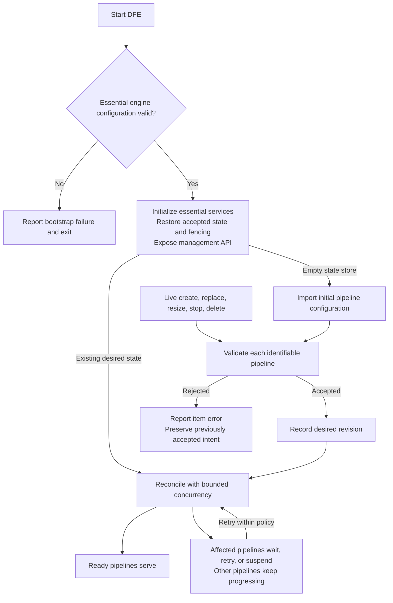
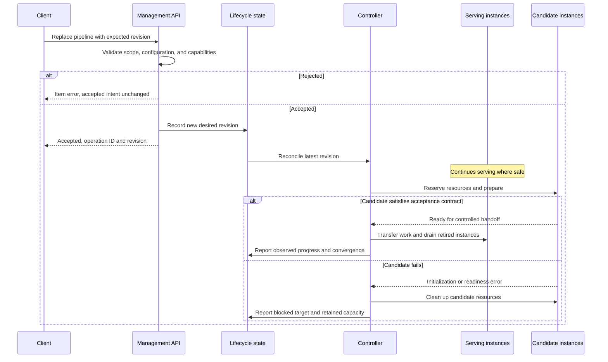
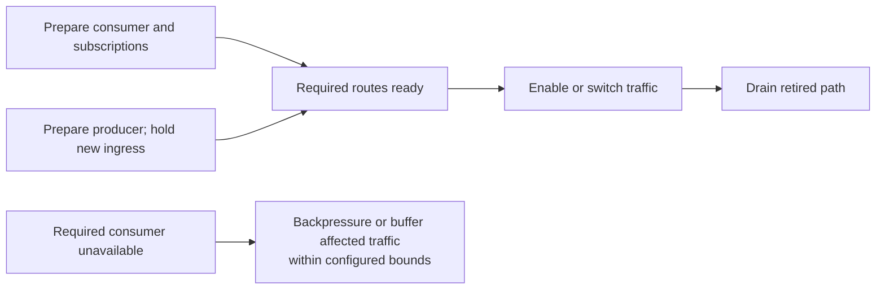

# RFC 0000: Independent Pipeline Lifecycle Reconciliation

## Summary

Treat the Dataflow Engine (DFE) as a long-lived host for independently managed
pipelines. Initial startup and live configuration changes use the same
reconciliation model: validate submitted intent, record accepted desired state,
and reconcile each pipeline toward it. Ordinary pipeline failures affect that
pipeline and its actual dependents; unrelated pipelines and the management API
remain available. Preserve working capacity during changes where component
capabilities permit, bound retries and resource use, and report acceptance,
availability, convergence, and delivery health separately.

## Motivation

A single DFE process can host hundreds of pipeline configurations, for example
one per tenant. Operators need to start, replace, resize, stop, and delete those
pipelines independently. One tenant's invalid exporter configuration or
unavailable destination should not prevent other tenants from receiving service
or make the management interface unavailable for repairs.

The operational contract should be the same whether a pipeline first appears in
a startup file or is created later through the API. Starting a process with 100
pipelines and adding 100 pipelines to a running process differ in existing
capacity, but should not have different failure boundaries.

The existing [live reconfiguration design][live-reconfiguration] already
provides per-pipeline operations, runtime generations, readiness gates, rolling
replacement, and progress reporting. It also documents in-memory configuration,
broader consistency guards for some operations, and engine shutdown when runtime
recovery is disabled or exhausted. This proposal establishes a consistent target
contract across these mechanisms, without depending on a particular startup
implementation.

The goals are fault containment, continued management access, predictable
recovery, and truthful results during partial progress. Cross-pipeline runtime
transactions, exactly-once telemetry delivery, arbitrary live changes to engine
bootstrap settings, and hard isolation between tenants are out of scope.

## Guide-level explanation

### One engine, independently managed pipelines

A logical pipeline is identified by `(pipeline_group_id, pipeline_id)` and may
run several instances on different cores. Pipeline groups organize configuration,
authorization, and resource policies. Membership alone does not make a group an
all-or-nothing startup or shutdown unit.

The engine establishes its essential services and management interface before
waiting for tenant pipelines. It then reconciles accepted pipeline intent with
bounded concurrency. Management remains available even if no tenant pipeline can
run. Live changes can repair pipelines while initial reconciliation is ongoing.

An unreadable configuration envelope, ambiguous identities, or invalid shared
settings reject the whole submitted document. When these prevent safe engine
bootstrap, the process exits with diagnostics. Once management can safely run,
a rejected import is a reported operation failure. It does not terminate the
engine or erase existing intent.

### Three different facts: submitted, desired, and observed

- **Submitted intent** is what a caller requests. It can be rejected.
- **Desired state** is the latest accepted configuration, capacity, and lifecycle
  state, identified by a monotonic revision for that pipeline.
- **Observed state** describes the actual instances, their generations,
  configuration revisions, capacity, readiness, and cleanup progress.

A revision identifies accepted intent. An instance generation identifies a
particular execution; recovery can create a new generation without changing the
desired revision. A rolling change can temporarily serve multiple revisions.

For example, revision 12 can be accepted while revision 11 continues serving
because the new exporter fails initialization:

| Fact | Example |
| --- | --- |
| Desired state | Running, revision 12, four cores |
| Observed serving state | Revision 11, four cores |
| Availability | Available under the declared acceptance contract |
| Convergence | Blocked; revision 12 has not been achieved |
| Reason | Candidate exporter initialization failed |
| Next action | Retry within budget, correct the configuration, or explicitly roll back |

If revision 12 had instead failed validation, it would never have become desired
state. Revision 11 would remain desired and observed, with a rejected submission
reported separately. Restoring old serving instances after an execution failure
also does not silently rewrite desired state. An explicit rollback records the
chosen older configuration as a new desired revision.

### Example: 100 pipelines in two groups

Assume two groups with 50 independent pipelines each, sufficient resources, and
one exporter that raises an initialization error when connecting to its
destination. The failure is pipeline-local; neither group is a failure domain.

| Situation | Expected result |
| --- | --- |
| Initial startup; one exporter cannot initialize | The other 99 pipelines start. The affected pipeline reports unavailable and retrying or suspended. Management remains ready. |
| Initial startup; one pipeline has invalid configuration | Reject that entry, show its validation error, and reconcile the other 99. No runtime is created for the rejected entry. |
| Live replacement of all 100; one candidate cannot initialize | The other 99 updates proceed. Retain the failed pipeline's previous serving instances where possible; its accepted desired revision remains unmet. |
| Live replacement of all 100; one entry is invalid | Reject that item and preserve its previous desired and observed state. Attempt the other 99 updates. |
| Live creation of several pipelines; one cannot start | Successful creates remain running. The failed accepted create remains visible and repairable, with no prior deployment to fall back to. |
| Corrective update arrives during startup | Accept it under the same revision rules as any live update; obsolete startup work cannot overwrite it. |

Dependencies change the affected set: a pipeline requiring the failed pipeline
can be blocked too. They do not justify stopping unrelated pipelines. Resource
limits can delay otherwise valid pipelines, so 99 successes are an eventual
outcome under the stated assumptions, not a simultaneous-start guarantee.

An exporter connection failure is not always a startup failure. Some exporters
connect lazily or retry while consuming buffered telemetry. In that case,
delivery health degrades; ingress availability follows the pipeline's buffering
and backpressure contract described below.

### Live changes preserve useful service

The diagram shows a supported replacement with overlap. It does not promise
that every component supports overlap, state transfer, or restoration. A change
requiring downtime must use an explicit disruptive policy; the controller must
not silently choose to stop healthy service because spare capacity is missing.

## Reference-level explanation

### Invariants and failure boundaries

The lifecycle controller must preserve these invariants:

1. Rejected submissions do not change accepted desired state.
2. Ordinary pipeline errors do not request engine shutdown. Recovery exhaustion
   is a pipeline condition, not an engine-fatal error.
3. A stale worker cannot publish serving state, change desired state, or restart
   a pipeline after a newer revision, stop, or delete has superseded it.
4. Reported convergence refers to the requested revision and capacity, with
   obsolete instances and resources cleaned up as required by the operation.
5. Resource ownership persists until release is observed. A timeout alone does
   not establish that a thread stopped or a port became reusable.
6. Preparation and handoff preserve the configured telemetry acceptance,
   acknowledgement, buffering, and backpressure contracts.

An engine-level fault is one that makes shared safety or control-plane progress
unreliable: for example, corruption of authoritative state or failure of an
essential runtime service. It can require protective shutdown. A failure of a
tenant's destination, authentication, component, or retry budget is not such a
fault. Classify essential services explicitly; an observability export outage
alone must not make otherwise functional management unavailable.

This is logical containment within a process. A process abort, native-library
fault, or process-wide out-of-memory event can still affect every tenant. Hard
fault and security isolation require separate processes or stronger boundaries.

### Validation and admission

Validation is layered so the engine can distinguish document-wide errors from
identifiable pipeline errors:

1. Parse the envelope and validate identities, ownership scope, and shared
   settings. Reject duplicate or ambiguous pipeline identities rather than
   choosing a winner by input order.
2. Decode and validate individual entries, resolve inherited policies, check
   component capabilities, and report errors with their pipeline identity and
   configuration path.
3. Check dependencies and shared constraints against a consistent versioned
   snapshot. Reserve conflicting names and exclusive resources through admission
   or scheduling, never through a race between launch workers.
4. Record accepted desired state and schedule reconciliation. Admission is not
   evidence that a destination is reachable or runtime convergence will succeed.

Partial admission requires an entry-aware loader. Deserializing the entire file
into one typed configuration and failing at the first invalid entry does not
implement this contract. Syntactically malformed input that cannot be reliably
partitioned still fails at the envelope level.

An entry that depends on a rejected or unavailable entry must report the missing
dependency and cannot become available prematurely. Unsupported live mutations
are rejected with a reason such as `RestartRequired`; they must not be accepted
as if the controller could eventually apply them.

Policy violations, such as a requested allocation exceeding an authorized
quota, are admission errors. Temporary resource scarcity for an otherwise
permitted request leaves accepted intent pending with a resource reason. Shared
policy changes must be validated over their actual affected scope. Until a safe
shared-policy update protocol exists, reject those mutations explicitly.

### Batch semantics and deletion safety

The default batch mode admits and reconciles independent items independently.
One rejected or failed item does not prevent attempting later independent
items. Every item receives an admission result and, if accepted, an operation
identifier. Completed successes remain applied when another item fails.

Aggregate results distinguish `InProgress`, `Succeeded`, `PartiallySucceeded`,
and `Failed`. A terminal result is `Succeeded` only when all items succeed;
mixed success and rejection, failure, or supersession is `PartiallySucceeded`.
A batch with no successful items is `Failed`. An accepted no-op counts as a
success. Pending items keep the batch in progress until their operation deadline
or another terminal event. Per-item results remain authoritative.

An optional `validate-all` mode can reject a batch unless every desired-state
change can be admitted together. Its transaction covers desired-state admission
only. Runtime execution can still partially fail. A consistent snapshot and
atomic store update are required before offering that mode.

Snapshots must declare their management scope and whether omission means
deletion. The default is non-destructive: omission retains existing entries.
Pruning requires an explicitly requested, complete, validated inventory in an
authorized scope. If any entry in that inventory is rejected, perform no
omission-based deletion; valid non-destructive items may still proceed under
independent admission. An invalid present entry is never treated as absent.

Configuration rollback cannot undo telemetry already emitted, acknowledgements
already sent, or external side effects. This RFC does not provide atomic runtime
rollout across a group or the engine.

### Operations and completion criteria

| Operation | Execution rule | Success criterion |
| --- | --- | --- |
| Create or start | Reserve resources, prepare dependencies and instances, then enable safe ingress. Keep accepted failed creates visible. | Desired instances serve the accepted revision and required cleanup is complete. |
| Replace | Prepare candidates while retaining service where supported; hand off traffic and state under declared component capabilities. | Desired revision and capacity serve; retired instances have released their resources. |
| Scale up | Keep current instances running; add capacity within quotas and concurrency limits. Safe new capacity may serve before all additions succeed. | Actual serving capacity reaches the desired allocation. |
| Scale down | Stop assigning new work to selected instances, drain them, then release resources. | Desired capacity remains and removed instances are confirmed stopped. |
| Stop | Record `Stopped` intent before draining, and fence launch and recovery work. Retain the pipeline configuration. | Ingress is stopped and all instances have relinquished resources. |
| Delete | Record deletion intent, stop instances, remove owned resources, then finalize deletion. | Cleanup is confirmed and stale work cannot recreate the pipeline. |

Create and scale operations can be available before converged when the pipeline
supports partial capacity and meets its declared minimum availability. Pipelines
requiring a complete partition or core set must wait for that set. Scale to zero
should use explicit `Stopped` intent rather than an ambiguous running allocation
of zero cores.

Replacement needs bounds on temporary capacity and permitted unavailability.
Exclusive listeners, non-transferable checkpoints, or incompatible processor
state can prohibit overlap. The controller either selects a supported handoff
or reports that an explicit disruptive change is required. When failure follows
a partial handoff, it retains safe capacity and attempts restoration only where
supported. Mixed revisions and failed restoration remain visible.

Drain has a deadline and a declared policy for remaining work. A timeout does
not mean successful delivery or cleanup. If a thread cannot be joined, retain
its ownership claims and report `CleanupStalled`; do not reuse its exclusive
state or bindings. In-process threads cannot generally be forcibly terminated
safely. A force/drop option is valid only where the runtime can implement its
documented behavior and account for abandoned work.

### Dependencies and traffic handoff

Actual data dependencies determine coordination scope, including topics shared
across groups. Prepare required consumers, subscriptions, and routes before
releasing upstream traffic. Apply this rule to startup, create, replacement,
resize, and recovery.

Holding only newly created producers is insufficient when a producer is already
serving. Its old route must remain usable, or the affected traffic must be paused
or buffered during handoff. Subscription readiness and routing ownership must
be acknowledged; elapsed time is not a synchronization mechanism.

Detect unsupported dependency cycles at admission. Where the topic model permits
cycles, prepare subscriptions for the connected set before enabling ingress,
without requiring every member to deliver data before any member can become
ready. Required dependencies block their dependents, not the whole engine.
Explicit coupled deployment policies can later add stronger preparation gates;
group membership must not imply such a policy.

### Availability, delivery, and process health

| Signal | Meaning | Operational use |
| --- | --- | --- |
| Engine liveness | Essential engine machinery can make progress. | Restart a broken process. |
| Management readiness | The control plane can safely serve its advertised management operations. | Send configuration and inspect status. |
| Pipeline availability | This pipeline can safely accept work under its configured contract. | Admit or route that pipeline's traffic. |
| Pipeline convergence | Observed configuration and capacity match accepted desired state. | Decide whether a deployment reached its target. |
| Delivery health | Export progress, errors, backlog, and losses. | Detect downstream problems and delivery risk. |

Process liveness and general management readiness must not be the logical AND
of all tenant pipeline health. An optional deployment check can require a chosen
set of pipelines to converge, and a waiting client can exit unsuccessfully on
partial failure, without terminating the daemon. Shared traffic routing also
needs a tenant-aware admission mechanism; removing the entire process from
service for one unavailable tenant defeats failure containment.

Each component must expose meaningful preparation and acceptance capabilities.
A receiver binding successfully or a runtime thread existing does not prove
that the whole pipeline can accept work safely. A successful exporter connection
does not prove future delivery either.

With suitable durable, bounded buffering, a disconnected destination can leave
a pipeline available until its buffer reaches the configured admission limit.
The acknowledgement contract must state when data becomes durable. Memory-only
buffering has different crash-loss semantics and must not be presented as
durable acceptance. Without sufficient buffering, apply backpressure, refuse
new work, or follow an explicitly configured loss policy. No failure mode may
create an unbounded queue.

### Recovery, deadlines, and retry budgets

| Failure | Response |
| --- | --- |
| Invalid pipeline configuration | Reject the submission; do not retry unchanged invalid input. |
| Transient destination failure | Use the component's bounded retry and backpressure contract; reconcile instances only when lifecycle repair is needed. |
| Temporary resource shortage | Wait with a resource reason; preserve existing service and avoid overcommit. |
| Candidate initialization failure | Clean up the candidate, retain safe existing capacity, and retry only when classified as retriable. |
| Serving instance error or contained panic | Recover the affected instance under its current desired intent and budget. |
| Retry budget exhausted | Suspend automatic attempts for the affected revision or instance; alert and keep management available. |
| Cleanup cannot be confirmed | Report stalled cleanup and retain ownership claims. |
| Unsafe engine-level failure | Report the reason and enter protective shutdown or a defined restricted state. |

Use exponential backoff with jitter, per-pipeline attempt budgets, and global
limits on launch and retry concurrency. Permanent credential or configuration
errors wait for relevant change or operator action. A new relevant revision,
dependency recovery, or explicit retry can re-enable reconciliation. Any
periodic probe after suspension must be an explicit bounded policy. A flapping
pipeline must not continually reset its budget without a defined stable period.

Component retries and controller retries must have distinct responsibilities.
Do not restart a functioning exporter for each transient RPC failure or multiply
its internal retries with unbounded lifecycle attempts.

Distinguish a client wait timeout, a single attempt deadline, and an operation
deadline. A client timeout only ends waiting. An operation timeout records a
terminal result for that operation; it does not erase desired intent, prove
cleanup, or forbid later convergence under the retry policy. Later recovery is
reported through new attempts and current pipeline status, without rewriting a
historical failed operation as successful. Canceling observation is not stopping
a pipeline; changing its target requires explicit new intent.

### Concurrency, fencing, and resource ownership

Serialize lifecycle execution per logical pipeline while admitting independent
pipelines concurrently. Accepted changes use optimistic revision checks so a
stale client cannot overwrite newer intent. New intent may supersede ongoing
work: fence the old worker, record its operation as superseded, and bring its
resources to a known safe state before a conflicting handoff. Stop and delete
must cancel or fence pending launch, retry, and recovery work promptly.

The initial file import is a versioned admission operation too. It cannot replay
an older entry over a corrective API update that arrived during startup. Load
the authoritative baseline before enabling mutations, or commit imported items
with version guards against the baseline captured for the import.

Workers carry pipeline identity, desired revision, and instance generation.
Every serving-state publication and resource transfer verifies current
ownership. Stale workers may finish cleanup of their own resources but cannot
commit current state. Identity reuse after deletion requires a new incarnation
identifier, or equivalent fencing that survives deletion and recreation.

Bound pending requests, active workers, retained operation history, and resource
reservations. Schedule fairly across configured tenant or pipeline scopes so a
large batch or flapping tenant cannot monopolize startup capacity. Reserve CPU,
memory, threads, buffer space, and exclusive bindings as applicable before
launch. Release reservations only after observed release; account for temporary
replacement capacity explicitly.

Shared constraints can require short coordinated admission transactions or
resource locks. Do not hold an engine-wide lock while connecting, building,
waiting for readiness, or draining. Preserve the thread-per-core, share-nothing
data plane: reconciliation coordination belongs in the control plane and must
not introduce a shared lifecycle lock into telemetry processing.

### API results, observability, and durability

Acceptance and completion are separate API events. An asynchronous accepted
operation returns an identifier, target revision, and a status location, such as
through HTTP `202 Accepted`. Validation errors, revision conflicts, and exhausted
request capacity receive distinct errors. A mixed batch reports every item;
transport-level success must not imply that every pipeline changed successfully.

Pipeline and operation status must expose:

- Desired lifecycle, revision, and capacity; observed serving revisions,
  generations, and actual capacity.
- Availability and convergence conditions, dependency and resource blockers,
  current execution stage, and cleanup state.
- Structured failure reason, retry classification, attempts, deadlines, and
  next retry where applicable.
- Per-item and aggregate outcomes, with watch or wait against a specific target
  revision and an explicit superseded result.

Requests need idempotency semantics so a lost acceptance response can be retried
without creating duplicate intent. Bound the deduplication and operation-history
retention windows and expose expiration; do not promise indefinite lookup.
Metrics summarize state and transitions; detailed errors belong in bounded
status and events. Do not place revisions or unbounded error strings in metric
labels. Authorize reads and mutations by management scope and redact credentials
from errors, stored submissions, logs, and status responses.

Choose one authoritative desired-state source for each managed scope. The
recommended standalone mode durably records accepted live changes before
acknowledging them. The startup file seeds an empty state store; later file
imports are explicit versioned operations. Restart must not silently revert live
changes to an older file. Persist stop and deletion intent, fencing information,
and enough operation metadata to explain interrupted operations. Rebuild observed
runtime state on restart and reconcile from the durable desired state.

An externally managed mode can instead rely on an authoritative controller that
reliably replays intent. Its API must disclose its persistence and restart
contract. Static files and an external controller must not compete as
unversioned writers. Existing ephemeral behavior may remain an explicitly
documented compatibility mode; it cannot claim the standalone durability
guarantee. Durable storage also needs atomic writes, recovery from interrupted
writes, schema versioning, and protection of sensitive configuration.

### Implementation and migration

The design spans these existing areas:

- `crates/config`: entry-aware validation, desired and observed models,
  dependency checks, policies, and structured failure reasons.
- `crates/controller`: startup import, per-pipeline reconciliation, revision
  fencing, bounded scheduling, recovery, and authoritative-state persistence.
- `crates/engine` and component crates: preparation, acceptance, handoff, drain,
  and resource-release contracts.
- `crates/admin`, `crates/admin-api`, and `crates/admin-types`: admission and
  operation responses, status, waits, health, and compatibility handling.

Introduce the model in stages: first separate desired and observed state and
establish fencing; then unify startup and live reconciliation with management
available early; then isolate batch admission and failure recovery; finally
enable durable authority and supported handoff capabilities. Durability and
partial admission must not be advertised until their full contracts are met.

Existing clients may interpret committed configuration as both intent and
serving state, rely on engine shutdown for failed recovery, or expect a startup
file to overwrite live changes after restart. Preserve old response fields only
with their documented meaning, add explicit desired and observed views, and
version incompatible API changes. Document the new health and persistence
semantics before changing defaults. Provide a validate-and-wait client workflow
for deployments that require all selected pipelines to converge.

This RFC changes no runtime behavior by itself. Implementation PRs must update
the live reconfiguration documentation, operational examples, and release notes
for the behavior they enable.

### Validation plan

Acceptance tests must demonstrate the operational contract, including:

- Both 100-pipeline examples, with failures in either group and at different
  positions in the batch; later independent items still execute.
- Isolated validation errors versus malformed envelopes, duplicate identities,
  rejected dependencies, and invalid entries in a pruning request.
- Corrective updates during startup, overlapping replacements, stop/delete
  during retry, stale completions, and deletion followed by identity reuse.
- Candidate failure before and after partial handoff, partial scale-up,
  scale-down drain failure, and cleanup that times out without releasing a port.
- Mixed topic create/replace/resize/recovery, including an already running
  producer; controlled handoffs protect the declared delivery contract.
- Exhausted retry budgets without engine shutdown, bounded global retries,
  scheduling fairness, and resource admission under saturation.
- Availability with a disconnected exporter, buffer saturation and
  backpressure, and independent management and deployment health checks.
- Restart after accepted updates, stop, and delete; interrupted durable writes;
  idempotent retry after a lost response; and expired operation history.

Use explicit readiness and ownership acknowledgements, controlled clocks for
retry policy, and local fault-injection fixtures. Verify resource release and
telemetry outcomes, not only terminal status. Load tests should measure control
plane responsiveness, memory and thread bounds, and data plane latency while
hundreds of pipelines reconcile.

## Drawbacks

This model requires more state and more precise APIs than a fail-fast process.
Operators must understand partial success, desired-versus-observed divergence,
and multiple health signals. A process can remain alive while serving an old
configuration or no tenant pipelines, so convergence alerts and deployment
checks are essential.

Retaining service during replacement consumes temporary resources and complicates
state handoff. Some components cannot support overlap or safe restoration.
Durable intent adds storage, schema migration, and secret-handling requirements.
Entry-aware validation also requires changes beyond reusing whole-document
deserialization.

Bounded scheduling can increase startup and rollout duration. Dependency
coordination reduces independence where pipelines actually share data paths.
Logical containment remains weaker than process isolation.

## Rationale and alternatives

| Choice | Benefit | Cost or reason not selected as the default |
| --- | --- | --- |
| Independent desired-state reconciliation | Consistent startup/live semantics and limited tenant disruption. | More lifecycle state, fencing, and partial-result handling. |
| Fail the process on any pipeline failure | Simple exit-status contract for small deployments. | One tenant can interrupt every tenant and remove the repair API. |
| Make each group an atomic failure unit | Simple when every group is a deliberately coupled application. | Group organization need not reflect dependencies; the failure boundary is arbitrary for independent tenants. |
| Atomic runtime rollout across all pipelines | Appealing single success/failure result. | External side effects cannot generally be rolled back; availability and resource costs grow with the batch. |
| Stop old instances before preparing replacements | Lower temporary resource needs and simpler exclusive-resource handling. | Creates avoidable downtime and sacrifices known working service; retain as an explicit supported disruptive policy. |
| Retry forever without limits | May eventually recover without operator action. | Can hide permanent errors and consume resources indefinitely. |
| Separate startup and live lifecycle implementations | Can simplify an initial startup implementation. | Duplicates failure semantics and permits divergent behavior for the same pipeline. |
| One process per tenant | Stronger resource and fault isolation. | Higher deployment and management cost; remains appropriate where hard isolation is required. |

Independent reconciliation best matches an engine hosting many distinct pipeline
configurations. Stronger deployment gates belong to explicitly selected scopes
and client policy. They should not implicitly redefine the engine's lifetime.

## Prior art

[Kubernetes controllers][controllers] separate desired state from observed state
and repeatedly act to reduce the difference. This is a useful control-plane
pattern, without requiring DFE to adopt Kubernetes APIs or its resource model.

[Kubernetes probes][probes] distinguish liveness, startup, and readiness because
restart and traffic admission answer different questions. DFE additionally needs
per-pipeline convergence and delivery signals in a shared process.

[Kubernetes Deployments][deployments] expose stalled rollout progress separately
from rollback; exceeding a progress deadline does not itself cause an automatic
rollback. This supports keeping accepted intent, observed service, and historical
operation outcomes distinct.

The DFE [live reconfiguration design][live-reconfiguration] supplies existing
generation, readiness, drain, and status concepts. This proposal extends those
concepts into a common operational contract for startup and ongoing management.

## Unresolved questions

- Which existing components support overlap, partial capacity, checkpoint
  transfer, and safe restoration? What common capability interface expresses
  these limits without overstating delivery guarantees?
- What durable store format and migration policy should standalone deployments
  use, and how should existing ephemeral deployments opt into it?
- Which API version introduces the new status and batch result shapes, and how
  long should compatibility behavior remain available?
- What default concurrency, retry, drain, and history limits fit expected
  workloads? The requirement to bound them is settled; values need measurement.
- What dependency declarations can be inferred safely from topic configuration,
  and which require explicit operator input?

The default failure boundary, independent batch execution, preservation of
accepted intent after rejection, and separation of availability from convergence
are proposed decisions, not deferred questions.

## Future possibilities

- Explicit coupled deployment sets with coordinated preparation and scoped
  deployment gates.
- Automated rollback policies that submit a new desired revision and record the
  decision, instead of silently mutating intent.
- Richer tenant scheduling, quota borrowing, and priority policies within fixed
  process safety limits.
- External durable control planes and multi-process placement for stronger
  isolation or larger deployments.

[live-reconfiguration]: ../docs/admin/live-reconfiguration.md
[controllers]: https://kubernetes.io/docs/concepts/architecture/controller/
[probes]: https://kubernetes.io/docs/concepts/workloads/pods/probes/
[deployments]: https://kubernetes.io/docs/concepts/workloads/controllers/deployment/
